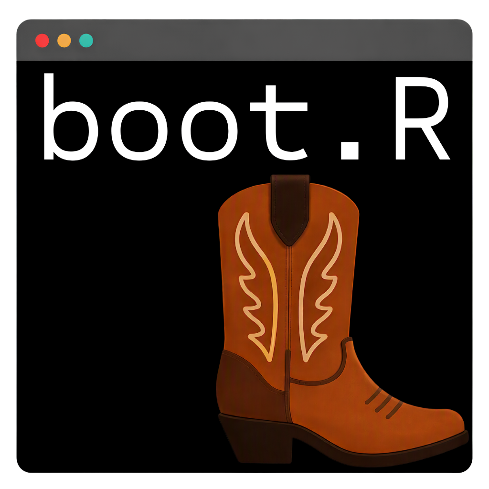
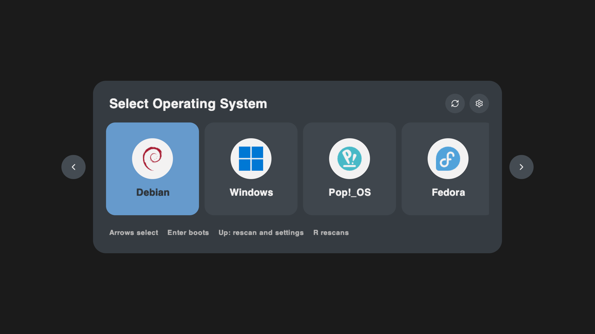
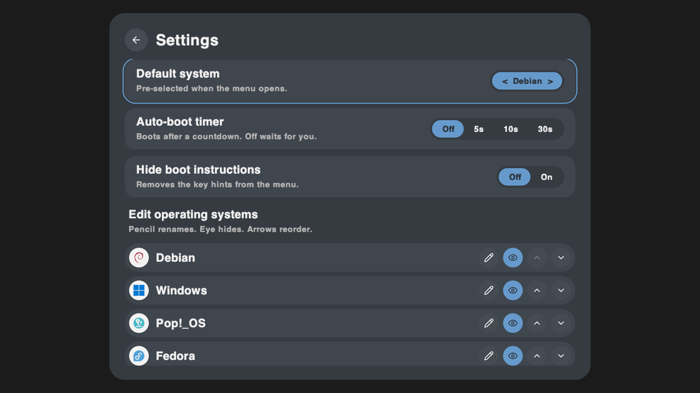
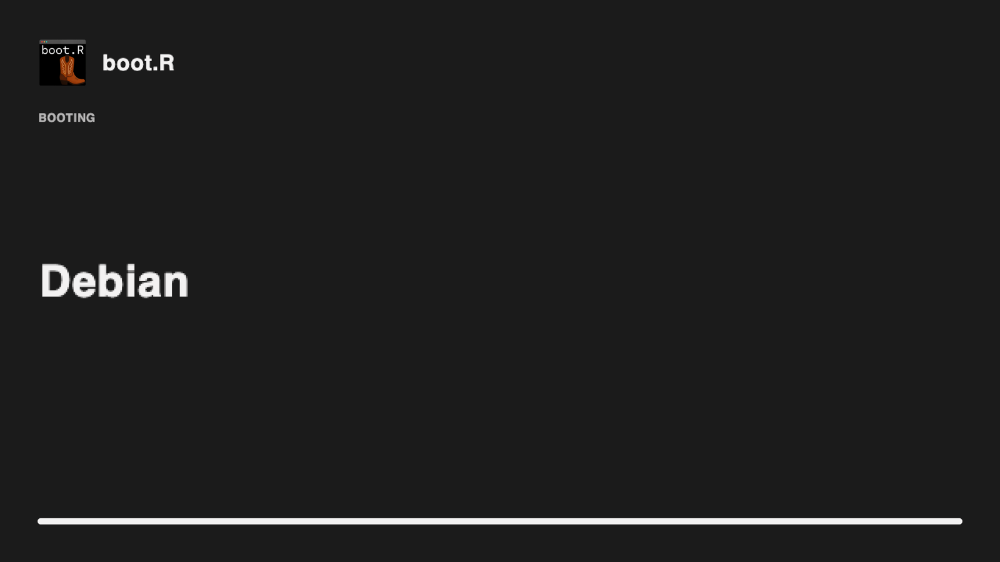

# boot.R: a standalone UEFI boot manager



[](https://github.com/azevedomedia0/boot.R/actions/workflows/build.yml)
[](LICENSE)

> **Use at your own risk.** A boot manager runs before your operating system. boot.R has been tested in QEMU/OVMF, not on real hardware. Keep a live USB, and try it from a USB stick (`make image`) before installing it to your internal drive.



A UEFI application written in plain C with no libraries (it carries its own tiny UEFI header, `src/uefi.h`), structured like rEFInd: scan every FAT volume's `\EFI\*` for loaders, draw a graphical menu through the Graphics Output Protocol, then `LoadImage`/`StartImage` the chosen one. The look and every setting from the prototype are implemented in the app itself.

## Build
Needs only a mingw-w64 cross compiler. It produces a PE32+ EFI application, so it builds the same on macOS and Linux.
```
brew install mingw-w64                      # Debian/Ubuntu: sudo apt install gcc-mingw-w64-x86-64
make                                        # -> bootR.efi (about 1 MB, no dependencies)
make image                                  # -> bootR.img, a 64 MiB USB-ready disk image (GPT + FAT32 ESP)
make dist                                   # -> dist/EFI/BOOT/BOOTX64.EFI, to copy onto an existing FAT32 stick
make deb                                    # -> boot-r_1.0.0_amd64.deb (Debian/Ubuntu package)
make flatpak                                # builds and installs the Flatpak (Linux, needs flatpak-builder)
make demo                                   # run in QEMU + OVMF with fake systems (needs qemu)
```
## Write the USB image
`bootR.img` boots on any x86_64 UEFI machine (turn Secure Boot off). It erases the stick. Pick the disk carefully:
```
diskutil list                               # find the stick, e.g. /dev/disk4 (check the size!)
diskutil unmountDisk /dev/disk4
sudo dd if=bootR.img of=/dev/rdisk4 bs=4m && diskutil eject /dev/disk4     # Linux: of=/dev/sdX bs=4M status=progress; sync
```
Or use balenaEtcher / Raspberry Pi Imager and choose `bootR.img`. Then pick the stick in your firmware's boot menu (F12, F8, Esc or Option, depending on the vendor).

## Install
**Debian / Ubuntu:** `sudo apt install ./boot-r_1.0.0_amd64.deb`, turn Secure Boot off, then `sudo boot-r-install`. Installing the package changes nothing on its own; the command adds boot.R to your EFI partition. `sudo boot-r-install --uninstall` removes it, and so does removing the package.

**Flatpak (self-hosted):** download `boot-r.flatpak` from the latest [CI run](https://github.com/azevedomedia0/boot.R/actions/workflows/build.yml) (artifact `boot-r-x86_64.flatpak`), then `flatpak install --user ./boot-r.flatpak` and open boot.R from the app menu. A sandbox cannot write to the EFI partition, so it asks the host to run the installer through `flatpak-spawn --host` and `pkexec`. That needs the `org.freedesktop.Flatpak` permission (Flathub does not accept it), plus `efibootmgr` and polkit on the host. The build and install of the bundle are tested in CI. Build it yourself with `make flatpak`.

**Flatpak, one step (from a source checkout):** `./install-flatpak.sh` (run as your normal user, not root) does the whole thing: installs any missing host tools (`flatpak`, `flatpak-builder`, `efibootmgr`, `pkexec`, `zenity`), the Flatpak SDK and LLVM compiler, builds and installs the Flatpak, runs it to add boot.R to the EFI partition, moves boot.R to the front of the boot order, then shows an alert window. It asks for your password with `sudo` in a terminal, or a graphical polkit prompt otherwise. Remove it with `flatpak run io.bootr.BootR --uninstall`.

**From a source checkout:**
```
sudo apt install efibootmgr
sudo ./install.sh
```
Copies the app to `<ESP>/EFI/bootR/` and adds it as the first boot entry, labelled `boot.R`. Existing entries stay; remove it with `efibootmgr -B`.

## Keys
- Left / Right: select a system. Enter: boot it. R: rescan.
- Up from the tiles: focus Rescan or Settings (Left/Right to switch, Enter to activate, Down to return).
- Any key cancels the auto-boot countdown.
- Settings: Up/Down move between rows, Left/Right change a value, Enter activates. Esc or the back button leaves. In "Edit operating systems": pencil renames (type, Enter saves, Esc cancels), eye hides, arrows reorder.

## How it maps to rEFInd
| Piece | here | rEFInd |
| --- | --- | --- |
| Discover systems | `src/store.c` scan_all | `main.c` ScanForLoaders |
| Draw | `src/gfx.c` GOP back buffer + Blt | `screen.c` |
| Menu | `src/main.c` draw_menu | `menu.c` |
| Boot | LoadImage/StartImage in boot() | `launch_efi.c` |
| Firmware entry | sets OsIndications, cold reset | same |
| Settings | UEFI NVRAM variable `BootMenuSettings` | `refind.conf` |
| UEFI types, runtime glue | `src/uefi.h`, `src/rt.c` | gnu-efi / EDK2 |

The boot.R icon (`assets/boot.R.png`) is embedded two ways: as a pixel array in `src/icon.c` (drawn in the menu header and boot splash; regenerate with `tools/mkicon.py`) and as a Windows icon resource in the `.efi` itself, so it shows in Windows Explorer. `assets/boot.R.icns` is the macOS version. UEFI firmware has no app-icon concept, so the boot menu entry itself shows firmware's own graphic.

`src/assets.c` holds the generated font bitmaps, brand logos (Simple Icons) and UI icons (Lucide), so the app has no files to load.

## Notes
- **Tested in QEMU + OVMF only:** the menu, boot handoff, settings (timer, hide hints, rename, hide, reorder, default system), persistence across reboots, and the USB image. Real firmware is unproven.
- Logos: Ubuntu (plus Kubuntu, Xubuntu, Lubuntu, Ubuntu MATE, Budgie, Studio, Cinnamon, Edubuntu), Windows, macOS, Debian, Pop!_OS, Fedora, Linux Mint, Arch, Manjaro, openSUSE, Zorin, Deepin, elementary, EndeavourOS, Raspberry Pi OS, KDE neon, MX Linux, Vanilla OS, NixOS, FreeBSD, Red Hat, Garuda, Bazzite, Android x86, Solus, CachyOS, Rocky, Gentoo, Void, Kali, ParrotOS, Alpine, Slackware. Flavours are matched by their \`\EFI\` folder name; most install under \`\EFI\ubuntu\`, so they show as Ubuntu. macOS shows up via OpenCore (\`\EFI\OC\`) or a readable \`\System\Library\CoreServices\boot.efi\`.
- Detected systems: other `\EFI\<dir>` loaders show with a disk icon. A volume with only a fallback `BOOTX64.EFI` shows as "Boot disk".
- Names are the distro folder name, not the version (Ubuntu, not Ubuntu 24.04). Rename in Settings.
- ASCII text only, x86_64 only, no mouse. Max resolution used is 2560x1440.
- Secure Boot: the app is unsigned.

## Screenshots
| Settings | Boot splash |
| --- | --- |
|  |  |

## Licence
boot.R is free software under the [GNU General Public License v3.0 or later](LICENSE). Copyright (C) 2026 Steven Azevedo.

The embedded brand logos come from [Simple Icons](https://simpleicons.org) (CC0-1.0) and the UI icons from [Lucide](https://lucide.dev) (ISC). The logos are trademarks of their owners and appear only to identify the operating systems they belong to.
